# Awesome AI Game

<a href="https://github.com/noobimp/awesome-ai-game">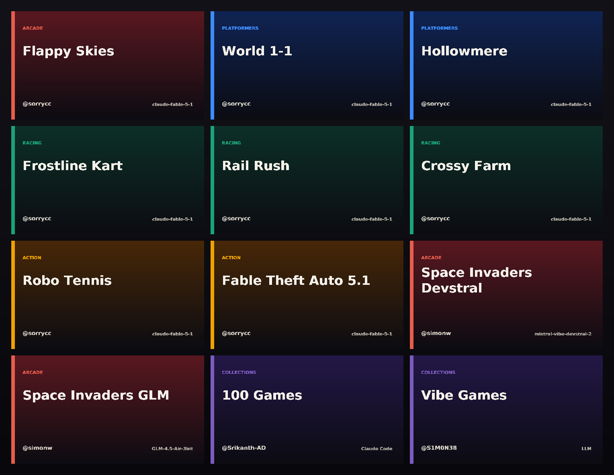</a>

Open-source HTML games people made with AI, each with the prompt the creator shared (or, where no prompt was published, their original project).

Every game here was made by asking a model to write the game as code (HTML, Canvas, JavaScript, Three.js and friends). Pick one, copy its prompt, and try it with your own agent.

**[▶ Browse the catalog on GitHub](https://github.com/noobimp/awesome-ai-game)**

<a href="https://github.com/noobimp/awesome-ai-game">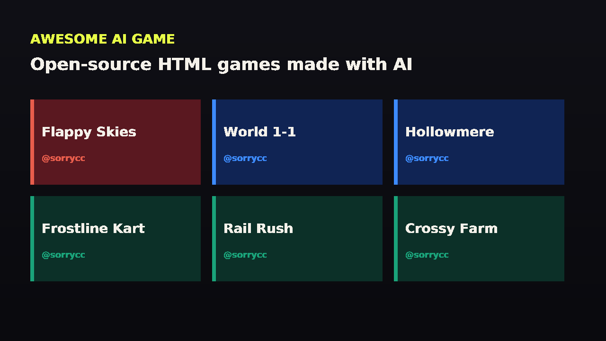</a>

- 12 prompts in [`prompts/`](prompts/) and [`data/games.json`](data/games.json), 12 of them playable in the browser
- 12 games highlighted below, grouped by how they play
- Every entry links to the creator's original project
- Latest update (2026-11-12): 12 games added, open-source HTML games made with AI
- 2026-11-12: add a game by opening a pull request on GitHub

## Contents

- [Arcade](#arcade) (3)
- [Platformers](#platformers) (2)
- [Racing](#racing) (3)
- [Action](#action) (2)
- [Collections](#collections) (2)
- [Latest prompts](#latest-prompts) (12)
- [How to use a prompt](#how-to-use-a-prompt)
- [Credits](#credits)

## Arcade

<table>
<tr><td width="33%" valign="top"><a href="https://sorrycc.github.io/fable-arcade/games/flappy-bird/">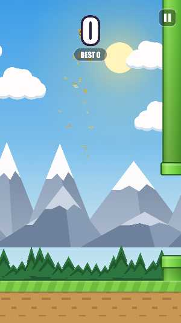</a> <a href="https://github.com/sorrycc"><b>@sorrycc</b></a> · <a href="prompts/flappy-skies.md">Prompt</a> Canvas · Web Audio</td><td width="33%" valign="top"><a href="https://space-invaders.simonwillison.net/mistral-vibe-devstral-2/">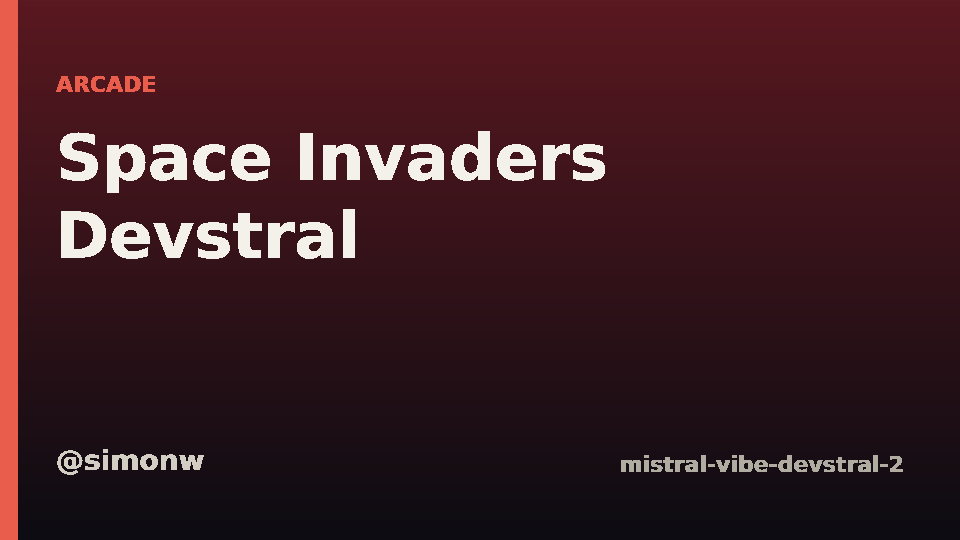</a> <a href="https://github.com/simonw"><b>@simonw</b></a> · <a href="prompts/space-invaders-mistral.md">Prompt</a> Three.js · HTML</td><td width="33%" valign="top"><a href="https://space-invaders.simonwillison.net/GLM-4.5-Air-3bit/">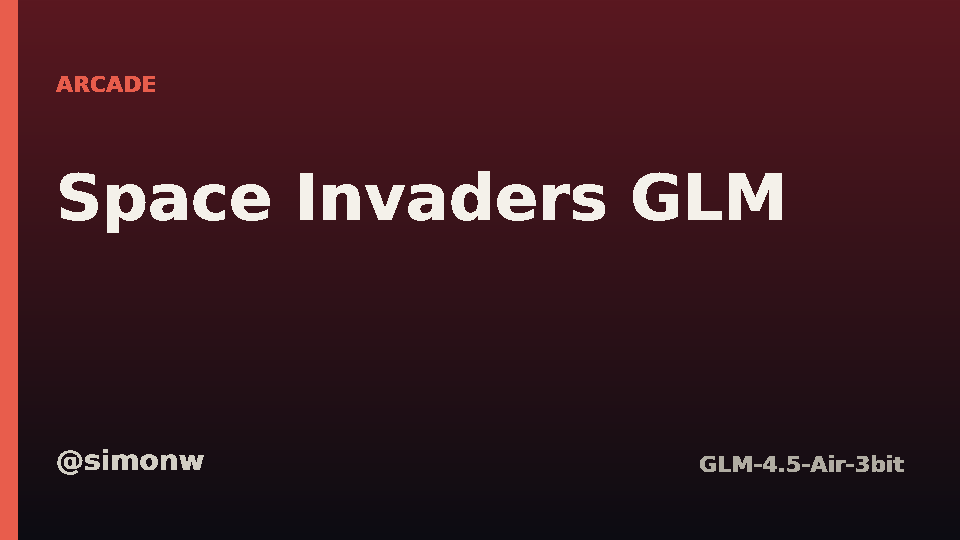</a> <a href="https://github.com/simonw"><b>@simonw</b></a> · <a href="prompts/space-invaders-glm.md">Prompt</a> HTML · JavaScript</td></tr>
</table>

## Platformers

<table>
<tr><td width="33%" valign="top"><a href="https://sorrycc.github.io/fable-arcade/games/mario-1-1/">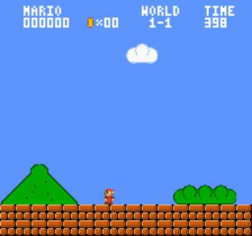</a> <a href="https://github.com/sorrycc"><b>@sorrycc</b></a> · <a href="prompts/world-1-1.md">Prompt</a> Canvas</td><td width="33%" valign="top"><a href="https://sorrycc.github.io/fable-arcade/games/terraria-sandbox/">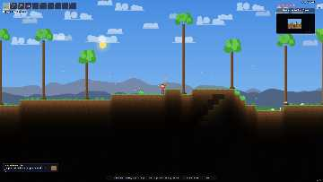</a> <a href="https://github.com/sorrycc"><b>@sorrycc</b></a> · <a href="prompts/hollowmere.md">Prompt</a> Canvas</td></tr>
</table>

## Racing

<table>
<tr><td width="33%" valign="top"><a href="https://sorrycc.github.io/fable-arcade/games/mario-kart-snow/">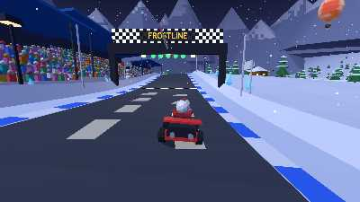</a> <a href="https://github.com/sorrycc"><b>@sorrycc</b></a> · <a href="prompts/frostline-kart.md">Prompt</a> Three.js</td><td width="33%" valign="top"><a href="https://sorrycc.github.io/fable-arcade/games/subway-runner/">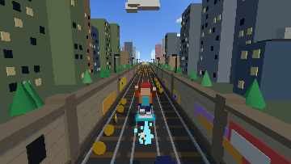</a> <a href="https://github.com/sorrycc"><b>@sorrycc</b></a> · <a href="prompts/rail-rush.md">Prompt</a> Three.js</td><td width="33%" valign="top"><a href="https://sorrycc.github.io/fable-arcade/games/crossy-farm-car/">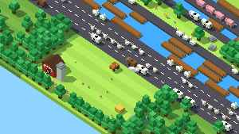</a> <a href="https://github.com/sorrycc"><b>@sorrycc</b></a> · <a href="prompts/crossy-farm.md">Prompt</a> Three.js</td></tr>
</table>

## Action

<table>
<tr><td width="33%" valign="top"><a href="https://sorrycc.github.io/fable-arcade/games/robot-tennis/">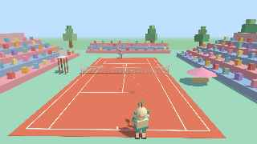</a> <a href="https://github.com/sorrycc"><b>@sorrycc</b></a> · <a href="prompts/robo-tennis.md">Prompt</a> Three.js</td><td width="33%" valign="top"><a href="https://sorrycc.github.io/fable-arcade/games/voxel-gta-city/">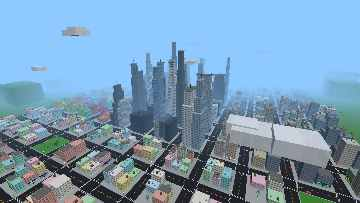</a> <a href="https://github.com/sorrycc"><b>@sorrycc</b></a> · <a href="prompts/fable-theft-auto.md">Prompt</a> Three.js</td></tr>
</table>

## Collections

<table>
<tr><td width="33%" valign="top"><a href="https://100games.net">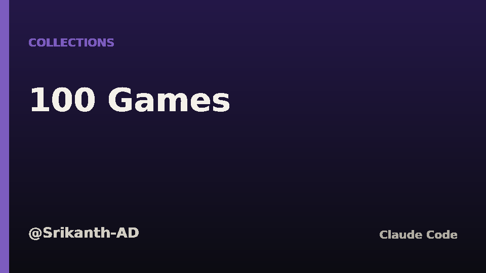</a> <a href="https://github.com/Srikanth-AD"><b>@Srikanth-AD</b></a> · <a href="prompts/hundred-games.md">Prompt</a> Canvas · Web Audio</td><td width="33%" valign="top"> <a href="https://github.com/S1M0N38"><b>@S1M0N38</b></a> · <a href="prompts/vibe-games.md">Prompt</a> HTML · CSS · JavaScript</td></tr>
</table>

## Latest prompts

The newest prompts in the catalog, each linking to the creator and the prompt file. All of them are in [`prompts/`](prompts/).

<table>
<tr><td width="33%" valign="top"> <a href="prompts/robo-tennis.md"><b>Robo Tennis</b></a> <a href="https://github.com/sorrycc">@sorrycc</a></td><td width="33%" valign="top"> <a href="prompts/fable-theft-auto.md"><b>Fable Theft Auto 5.1</b></a> <a href="https://github.com/sorrycc">@sorrycc</a></td><td width="33%" valign="top"> <a href="prompts/world-1-1.md"><b>World 1-1</b></a> <a href="https://github.com/sorrycc">@sorrycc</a></td></tr>
<tr><td width="33%" valign="top"> <a href="prompts/rail-rush.md"><b>Rail Rush</b></a> <a href="https://github.com/sorrycc">@sorrycc</a></td><td width="33%" valign="top"> <a href="prompts/hollowmere.md"><b>Hollowmere</b></a> <a href="https://github.com/sorrycc">@sorrycc</a></td><td width="33%" valign="top"> <a href="prompts/frostline-kart.md"><b>Frostline Kart</b></a> <a href="https://github.com/sorrycc">@sorrycc</a></td></tr>
<tr><td width="33%" valign="top"> <a href="prompts/flappy-skies.md"><b>Flappy Skies</b></a> <a href="https://github.com/sorrycc">@sorrycc</a></td><td width="33%" valign="top"> <a href="prompts/crossy-farm.md"><b>Crossy Farm</b></a> <a href="https://github.com/sorrycc">@sorrycc</a></td><td width="33%" valign="top"> <a href="prompts/hundred-games.md"><b>100 Games</b></a> <a href="https://github.com/Srikanth-AD">@Srikanth-AD</a></td></tr>
<tr><td width="33%" valign="top"> <a href="prompts/space-invaders-mistral.md"><b>Space Invaders Devstral</b></a> <a href="https://github.com/simonw">@simonw</a></td><td width="33%" valign="top"> <a href="prompts/space-invaders-glm.md"><b>Space Invaders GLM</b></a> <a href="https://github.com/simonw">@simonw</a></td><td width="33%" valign="top"> <a href="prompts/vibe-games.md"><b>Vibe Games</b></a> <a href="https://github.com/S1M0N38">@S1M0N38</a></td></tr>
</table>

## How to use a prompt

1. Open a prompt file and copy the block under **Prompt**.
2. Paste it into the model named on the entry (or any coding agent).
3. Ask it to render the result as a single HTML file, then open that file in a browser.

Some creators shared only part of their prompt, or only described the result in their project; those files say so.

## Credits

Every game and prompt belongs to its creator, linked from each entry. Flappy Skies, World 1-1, Hollowmere, Frostline Kart, Rail Rush, Crossy Farm, Robo Tennis, and Fable Theft Auto use a frame from the running game. Space Invaders Devstral, Space Invaders GLM, 100 Games, and Vibe Games still use title cards. If you are a creator and want an entry changed or removed, open an issue.

The catalog and this website's code are MIT. Each game stays under its creator's own license.

The catalog is on **[GitHub](https://github.com/noobimp/awesome-ai-game)**.

Interested, or want to contribute? Open a pull request on [GitHub](https://github.com/noobimp/awesome-ai-game/pulls).
