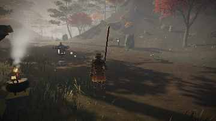

# 黑神话悟空 by @oneoyn

[▶ Play](https://wukong.cnmwx.com/) · [Original project](https://wukong.cnmwx.com/)



- **Category:** Action
- **Built with:** WebGL · JavaScript
- **Model:** not recorded
- **Author:** [@oneoyn](https://www.v2ex.com/member/oneoyn)
- **Conversation:** https://www.v2ex.com/t/1244710

## Prompt

The creator did not publish a single prompt for this entry. They described the project instead.

```text
A V2EX post by oneoyn says an AI wrote this browser fan game from scratch: 3D, skeletal animation, boss fights, spells, and guzheng, on one page with no stock assets. The page footer says it is an unofficial fan tribute inspired by Black Myth: Wukong, unrelated to Game Science, and that the models, animation, music, and sound effects are made by the program, with CC0 scans used for snow and bark. The page does not name a model or publish a prompt.
```
