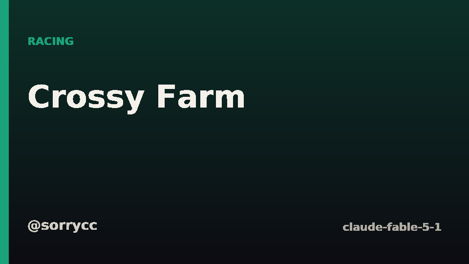

# Crossy Farm by @sorrycc

[▶ Play](https://sorrycc.github.io/fable-arcade/games/crossy-farm-car/) · [Original project](https://github.com/sorrycc/fable-arcade)



- **Category:** Racing
- **Built with:** Three.js
- **Model:** claude-fable-5-1
- **Author:** [@sorrycc](https://github.com/sorrycc)
- **Conversation:** https://github.com/sorrycc/fable-arcade/blob/main/games/crossy-farm-car/README.md

## Prompt

```text
Build a single index.html with Three.js from a CDN: a Crossy Road clone where
you're the car and the traffic is farm animals.

Must have
- Voxel isometric look: flat-shaded box geometry, grass strips packed with
  cube trees and rocks, dark roads with dashed lines, blue rivers with
  floating logs. Camera follows the car from a fixed diagonal angle.
- Grid-hop movement (arrows, WASD, swipe) with a little bounce. Herds of
  cows, pigs, and chickens cross roads in lanes at different speeds and
  directions. Rivers sink you unless you land on a log. Coins scattered on
  the grass.
- Score is the furthest row reached. Idle too long and something forces you
  to move, like the eagle in Crossy Road.
- Death card with a title and a one-line joke that matches the cause of death
  ("Sunk. Cars famously cannot swim."), plus score, best, coins earned, rank
  on your board, and a Drive again button.
- Title screen: big two-tone logo, a small pill above it saying "you're the
  car now", tagline "Hop the roads. Dodge the herds. Do not idle.", a Drive
  button, and Garage / Scores / Settings.
- Garage: around ten vehicles bought with coins, plus a mystery crate that
  unlocks a random one. The chosen vehicle is what you drive.
- Scores: local top-10 with the vehicle used per run, and totals for runs,
  coins found, and vehicles unlocked. Everything persists in localStorage.

Rules
- Endless procedural rows, no fixed level.
- Chunky rounded UI cards, cream and orange, playful copy on every screen.
- No external assets. All models are boxes built in code.
- Smooth at 60fps, works on phones.

Style, colors, animal roster, and everything else are up to you. Make it
feel alive.

Write the result to `index.html` in the current working directory: one HTML
file that runs as-is. The only external resource permitted is Three.js itself,
a version-pinned module from a CDN (e.g.
`https://unpkg.com/three@0.169.0/build/three.module.js`) loaded via an import
map; all of your own CSS and JS stays inline. No build step, no local asset
files.
```
