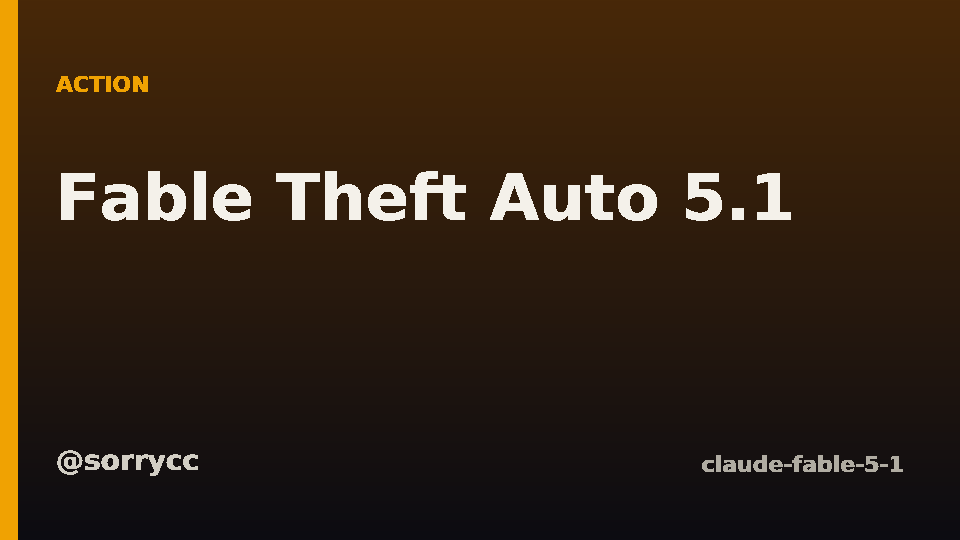

# Fable Theft Auto 5.1 by @sorrycc

[▶ Play](https://sorrycc.github.io/fable-arcade/games/voxel-gta-city/) · [Original project](https://github.com/sorrycc/fable-arcade)



- **Category:** Action
- **Built with:** Three.js
- **Model:** claude-fable-5-1
- **Author:** [@sorrycc](https://github.com/sorrycc)
- **Conversation:** https://github.com/sorrycc/fable-arcade/blob/main/games/voxel-gta-city/README.md

## Prompt

```text
Build a single HTML file (Three.js from a CDN is fine): a browser GTA clone in
a blocky Minecraft-style voxel city, called "Fable Theft Auto 5.1". One
mission: whack the snitch downtown.

Must have
- A city dense enough to get lost in. Blocks of mixed buildings with parody
  storefront signs, palm trees and a Ferris wheel on the waterfront, traffic
  that keeps to its lanes, pedestrians that wander and run when shots go off.
  Named districts and streets, shown bottom-left when you cross into them.
- The whole GTA loop. Third-person WASD + mouse shooter with pistol, shotgun,
  SMG and reload. Walk up to any car, F to jack it, W/S/A/D + handbrake to
  drive, F to get out. Run over a ped and there is blood on the road.
- Wanted level. Crimes add stars, "WANTED LEVEL ★★★" flashes mid-screen, cops
  spawn and hunt you, more of them per star. Taking damage tints the screen
  red. Dying shows a big pixel "WASTED", then you respawn at the hospital.
- The mission. Title card "THE DOWNTOWN HIT" on start, a persistent top-left
  briefing ("Vinny 'Snitch' Voxel sold out the crew...") with the current
  objective, a route on the minimap, bodyguards at the plaza, cash on
  completion.
- GTA HUD in a chunky pixel font. Stars, clock, cash, health bar, weapon icon
  with ammo, kills top-right. Minimap with north arrow and player marker
  bottom-left.
- Title screen over a slow aerial pan of the city, controls listed, "click to
  play" locks the pointer.

Rules
- Everything procedural. No model files, no textures, no assets.
- 30+ fps with hundreds of buildings and dozens of cars and peds. Instance or
  merge geometry.
- Cars have weight: they accelerate, slide on handbrake, and collide with
  buildings and each other instead of passing through.

Style, colors, car and building variety, sound, and everything else are up to
you. Make it feel alive.

Write the result to `index.html` in the current working directory: one HTML
file that runs as-is. The only external resource permitted is Three.js itself,
a version-pinned module from a CDN (e.g.
`https://unpkg.com/three@0.169.0/build/three.module.js`) loaded via an import
map; all of your own CSS and JS stays inline. No build step, no local asset
files.
```
