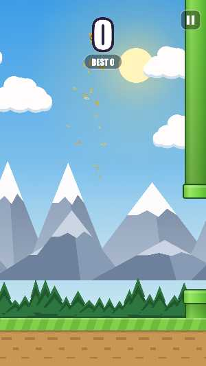

# Flappy Skies by @sorrycc

[▶ Play](https://sorrycc.github.io/fable-arcade/games/flappy-bird/) · [Original project](https://github.com/sorrycc/fable-arcade)



- **Category:** Arcade
- **Built with:** Canvas · Web Audio
- **Model:** claude-fable-5-1
- **Author:** [@sorrycc](https://github.com/sorrycc)
- **Conversation:** https://github.com/sorrycc/fable-arcade/blob/main/games/flappy-bird/README.md

## Prompt

```text
Build a single HTML file with Canvas 2D and no external assets: a polished
portrait Flappy Bird that plays in the browser with tap, click, or space.

Must have
- Sky cycles with distance, not time: bright morning → pink-orange sunset →
  purple dusk → starry night with a moon, over roughly the first 10 pipes.
  Clouds, mountains, and the sun glow retint with it; stars and ground
  fireflies fade in at night.
- Parallax layers: clouds, snowy mountains, pine tree line, striped grass
  ground, each scrolling at its own speed. Classic green pipes with a lip and
  a vertical gradient.
- Game feel: bird tilts with velocity and flaps; every flap sheds a few
  feathers; passing a pipe pops a "+1" and a sparkle ring; on death, a short
  hitstop, white flash, screen shake, then the bird tumbles to the ground in a
  feather burst.
- HUD: huge chunky outlined score at top center (Luckiest Guy or similar), a
  small "BEST n" pill under it that flips to a gold "NEW BEST!" pill plus a
  floating banner the moment you pass your record; pause button top right.
- Flow: menu → ready (tap to start) → playing → dying → game-over card with
  score, best, medal (bronze/silver/gold/platinum at 10/20/30/40), retry. Best
  persists in localStorage.
- All sounds synthesized with Web Audio: flap, score, hit, swoosh, medal
  jingle.

Rules
- Fixed-timestep physics at 60 fps, delta capped so a tab switch never
  teleports the bird. Pause on tab hide.
- Portrait canvas around 9:16, centered on the page, crisp on retina, fills a
  phone screen.
- Pipe gap and spacing never depend on frame rate. No unwinnable gaps.

Style, exact colors, bird design, and everything else are up to you. Make it
feel alive.

Write the result to `index.html` in the current working directory: a single
self-contained HTML file with inline CSS and JS, no external resources.
```
