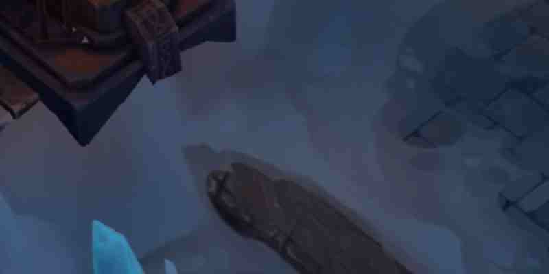

# 英雄联盟海克斯大乱斗 by @hanyue

[▶ Play](https://lol.hanyue.io/) · [Original project](https://lol.hanyue.io/)



- **Category:** Action
- **Built with:** HTML · JavaScript
- **Model:** not recorded
- **Author:** [@hanyue](https://lol.hanyue.io/)
- **Conversation:** https://linux.do/t/topic/3154879

## Prompt

The creator did not publish a single prompt for this entry. They described the project instead.

```text
The page publishes no author name, model, or prompt. It is an unofficial browser Hextech ARAM match and loads packaged game assets from its own site. A linux.do thread grouped it with one-shot Claude demos, and a reply there said it looks reverse-engineered. The page itself does not confirm a model.
```
