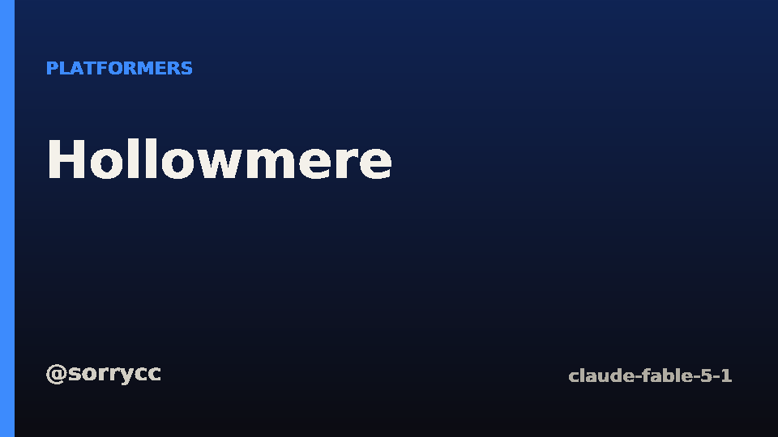

# Hollowmere by @sorrycc

[▶ Play](https://sorrycc.github.io/fable-arcade/games/terraria-sandbox/) · [Original project](https://github.com/sorrycc/fable-arcade)



- **Category:** Platformers
- **Built with:** Canvas
- **Model:** claude-fable-5-1
- **Author:** [@sorrycc](https://github.com/sorrycc)
- **Conversation:** https://github.com/sorrycc/fable-arcade/blob/main/games/terraria-sandbox/README.md

## Prompt

```text
Build a single HTML file (canvas, plain JS or whatever fits): a Terraria-style
2D sandbox survival game, playable start to boss kill.

Must have
- Tile world much wider than the screen: grass, dirt, stone, sand, water, trees,
  cacti. Two biomes at least (forest and desert), named in the HUD with an
  in-game clock and weather.
- Dig with a pickaxe, place blocks and walls, craft at a workbench. Inventory
  panel with hotbar, armor and accessory slots, and a crafting list that only
  shows recipes for stations nearby.
- Real day/night. Night is dark underground and on the surface; torches cast
  warm light with falloff.
- Parallax sky: clouds, distant mountains, sun and moon.
- One boss: use an item at night to summon a giant flying eye. Awakening banner,
  phased boss health bar at the bottom, small servant eyes, floating damage
  numbers.
- HUD with hearts, mana, selected item name, minimap of explored world, key hint
  bar, and a small "next discovery" tutorial card.

Rules
- Crisp pixel art, no image smoothing, 60 fps.
- Camera follows the player smoothly; physics is sub-tile, jump and fall feel
  weighty.
- Grapple hook, healing potion with cooldown, respawn on death.
- Everything runs in one file with no external assets. Draw sprites in code.

Style, palette, enemies, and everything else are up to you. Make it feel alive.

Write the result to `index.html` in the current working directory: a single
self-contained HTML file with inline CSS and JS, no external resources.
```
