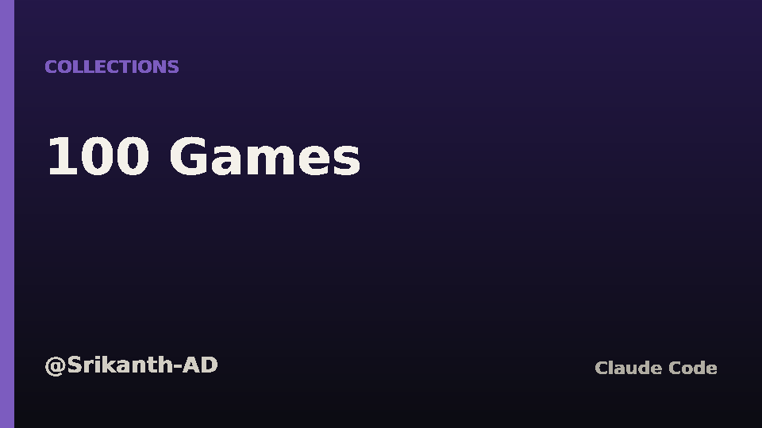

# 100 Games by @Srikanth-AD

[▶ Play](https://100games.net) · [Original project](https://github.com/Srikanth-AD/100games)



- **Category:** Collections
- **Built with:** Canvas · Web Audio
- **Model:** Claude Code
- **Author:** [@Srikanth-AD](https://github.com/Srikanth-AD)
- **Conversation:** https://github.com/Srikanth-AD/100games

## Prompt

The creator did not publish a single prompt for this entry. They described the project instead.

```text
The author built 100 self-contained HTML5 canvas games with Claude Code, each from a single prompt, in under 24 hours. They use vanilla JavaScript, no frameworks, and synthesized sound through the Web Audio API. The playable collection is at 100games.net.
```
