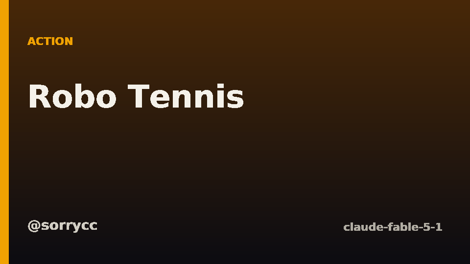

# Robo Tennis by @sorrycc

[▶ Play](https://sorrycc.github.io/fable-arcade/games/robot-tennis/) · [Original project](https://github.com/sorrycc/fable-arcade)



- **Category:** Action
- **Built with:** Three.js
- **Model:** claude-fable-5-1
- **Author:** [@sorrycc](https://github.com/sorrycc)
- **Conversation:** https://github.com/sorrycc/fable-arcade/blob/main/games/robot-tennis/README.md

## Prompt

```text
Build a single HTML file with Three.js: a third-person robot tennis game, you vs
a CPU, camera behind your player.

Must have
- Low-poly pastel court: coral-red surface with white lines, mint green apron,
  stepped bleachers in pink and blue, a few blocky trees. Flat shading, soft
  shadows.
- A chunky round-headed robot holding a racket. It picks a swing by where the
  ball is: forehand, backhand, overhead smash, and a serve with a toss. The
  swing must read as motion, not a pose swap.
- A ring on the ground showing where the ball will land, and a CPU robot on the
  far side that chases it.
- Real tennis scoring (15/30/40, deuce, games, sets) on a top-center
  scoreboard, plus a big mid-screen call when a point ends: OUT, MISSED, INTO
  THE NET, FAULT / second serve.
- Controls: WASD move, Shift sprint, Space or click to swing, hold a direction
  while swinging to aim.

Rules
- Ball has gravity and bounce and never passes through the net or racket.
- The CPU can hold a rally of several shots but misses sometimes.
- Serve alternates each game; a serve into the wrong box is a fault.
- 60 fps, no pops when animations change.

Style, colors, props, and everything else are up to you. Make it feel alive.

Write the result to `index.html` in the current working directory: one HTML
file that runs as-is. The only external resource permitted is Three.js itself,
a version-pinned module from a CDN (e.g.
`https://unpkg.com/three@0.169.0/build/three.module.js`) loaded via an import
map; all of your own CSS and JS stays inline. No build step, no local asset
files.
```
