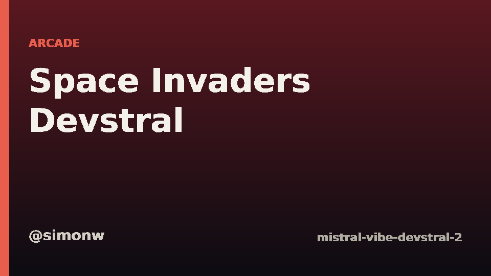

# Space Invaders Devstral by @simonw

[▶ Play](https://space-invaders.simonwillison.net/mistral-vibe-devstral-2/) · [Original project](https://github.com/simonw/space-invaders-by-llms)



- **Category:** Arcade
- **Built with:** Three.js · HTML
- **Model:** mistral-vibe-devstral-2
- **Author:** [@simonw](https://github.com/simonw)
- **Conversation:** https://github.com/simonw/space-invaders-by-llms/commit/6f2d9ed4b423167ad36d0a48a0a50a9ab9cf6b94

## Prompt

```text
make me a space invaders game as HTML with three.js loaded from a CDN
```
