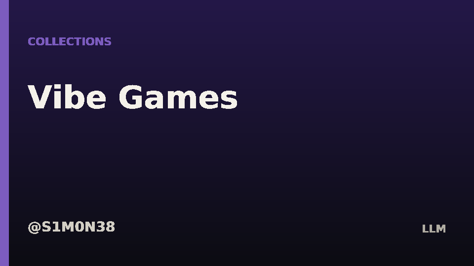

# Vibe Games by @S1M0N38

[▶ Play](https://s1m0n38.github.io/games/) · [Original project](https://github.com/S1M0N38/games)



- **Category:** Collections
- **Built with:** HTML · CSS · JavaScript
- **Model:** LLM
- **Author:** [@S1M0N38](https://github.com/S1M0N38)
- **Conversation:** https://github.com/S1M0N38/games

## Prompt

The creator did not publish a single prompt for this entry. They described the project instead.

```text
A collection of minimalist browser games in HTML, CSS, and JavaScript. Each game was generated by prompting a language model under a fixed set of rules, as a test of how well those models write simple games.
```
