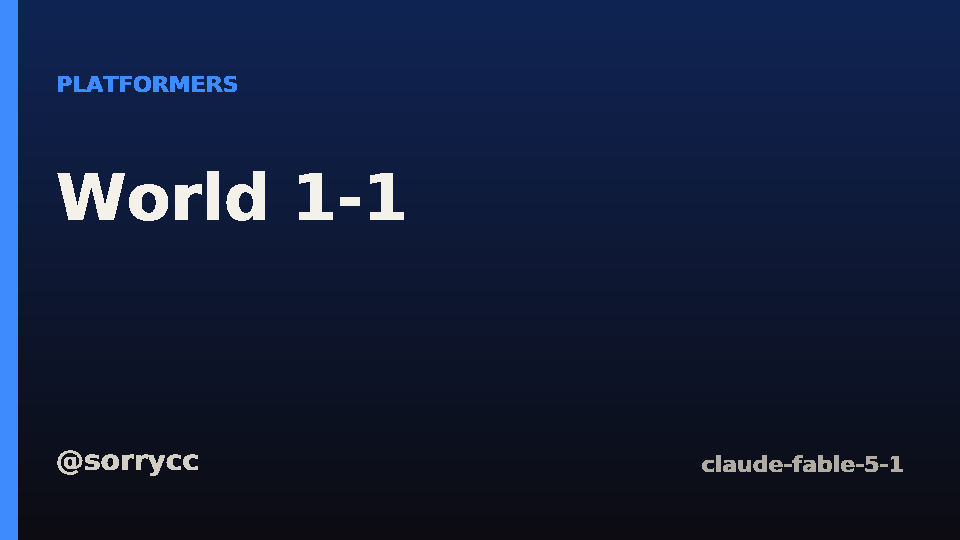

# World 1-1 by @sorrycc

[▶ Play](https://sorrycc.github.io/fable-arcade/games/mario-1-1/) · [Original project](https://github.com/sorrycc/fable-arcade)



- **Category:** Platformers
- **Built with:** Canvas
- **Model:** claude-fable-5-1
- **Author:** [@sorrycc](https://github.com/sorrycc)
- **Conversation:** https://github.com/sorrycc/fable-arcade/blob/main/games/mario-1-1/README.md

## Prompt

```text
Create a stage identical to Super Mario Bros. World 1-1.

It must be playable and bug-free. It should be fun.

Write the result to `index.html` in the current working directory: a single
self-contained HTML file with inline CSS and JS, no external resources.
```
